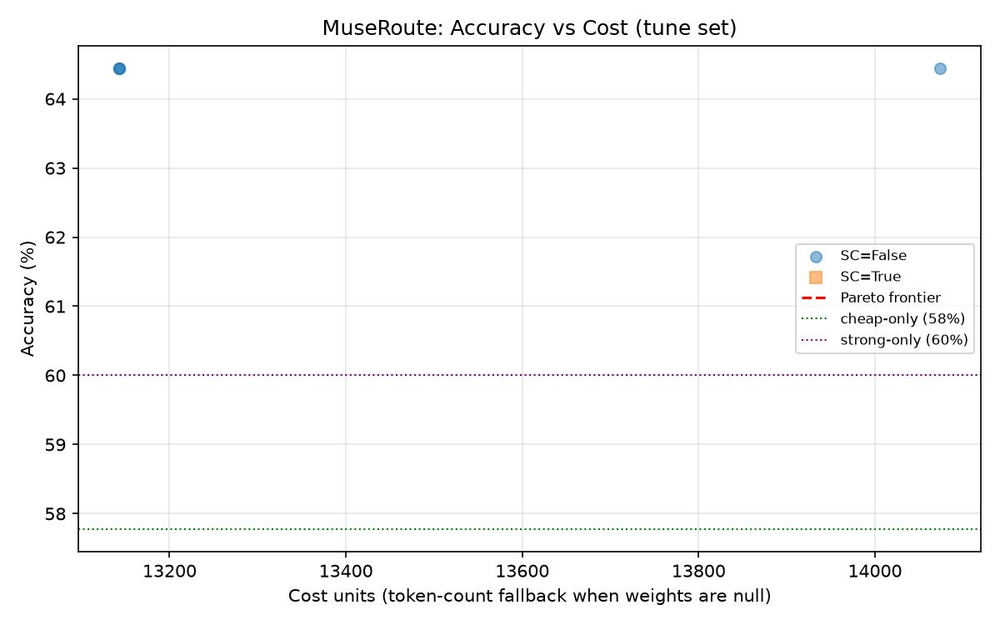

# MuseRoute

MuseRoute is a Python 3.11 project for making direct chat-completions requests through selectable Muse tiers, checking replies against a small workload, and comparing each tier's quality, latency, token use, and available cost data. Each tier can use its own OpenAI-compatible host and model. The policy requires `muse` somewhere in each configured model ID (case-insensitive) and blocks the `api.meta.ai` host.

## Muse models and tiers

The policy only permits model IDs containing `muse` (case-insensitive). The verified Hugging Face model ID `meta-models/Muse-Glimmer-30B` is one option. The `cheap` tier requests low reasoning strength and the `strong` tier requests high reasoning strength; the two tiers can point to the same or different Muse models and compatible hosts.

- **cheap** is the intended lower-cost tier for routine or simpler prompts. It reads `CHEAP_BASE_URL`, `CHEAP_MODEL_ID`, and optional `CHEAP_API_KEY` from `.env`; its `cost_weight` is a TODO.
- **strong** is the intended higher-capability tier for harder prompts. It reads `STRONG_BASE_URL`, `STRONG_MODEL_ID`, and optional `STRONG_API_KEY` from `.env`; its `cost_weight` is a TODO.

The paid Meta API host `api.meta.ai` is blocked at startup. MuseRoute does not otherwise restrict the host, so configure only endpoints you intend to use. The baseline runner calls each tier independently with the same workload; it does not route prompts between tiers.

## Run the local API

Start the server from the project root after configuring the tier endpoints and keys:

```powershell
uvicorn museroute.server:app --host 127.0.0.1 --port 8000
```

`POST /v1/chat/completions` accepts the standard chat-completions `messages` array and returns the usual `choices` and `usage` fields, plus `route_trace` with the selected tier, reason, latency, and cost units. `POST /api/route` returns the answer and full router trace. `POST /api/compare` sends the same messages to strong-only and MuseRoute. `GET /health` checks the configured model policy. The server reads its threshold and self-consistency setting from the selected `operating_point` in `results/sweep.json` when available; `MUSEROUTE_THRESHOLD` and `MUSEROUTE_SELF_CONSISTENCY` override those values. Without a saved sweep selection, it defaults to threshold `0.5` and self-consistency off.

Example request:

```bash
curl http://127.0.0.1:8000/v1/chat/completions \
  -H 'Content-Type: application/json' \
  -d '{"model":"museroute","messages":[{"role":"user","content":"Which number is larger, 9.11 or 9.8?"}]}'
```

## Setup

```powershell
py -3.11 -m venv .venv
.\.venv\Scripts\Activate.ps1
python -m pip install -r requirements.txt
Copy-Item .env.example .env
```

Fill in the six tier-specific variables in `.env` using `.env.example` as a template. Leave an API key empty for an endpoint that does not require one. The `.env` file is ignored by Git. Populate `cost_weight` from a trusted model card or measured relative compute data; no USD prices are configured.

## Run the checks

From the repository root, with the virtual environment active and tier settings/keys configured:

```powershell
python scripts/smoke.py
python scripts/baseline.py
```

`smoke.py` checks plain text, JSON output, token usage, payment errors, and configured `extra_params`. For the strong tier, it only tries reasoning parameter names that it can identify from verified host documentation.

`baseline.py` runs every prompt in `data/workload.jsonl` against each tier with temperature 0 where supported. It writes resumable per-prompt results to `results/baseline.json`, saves after each item, and skips completed entries on a later run. Press Ctrl-C to stop safely; rerun the command to resume.

## Baseline results — 2026-10-31

The prior baseline artifact consisted of 180 failed request records and has been removed. No valid model requests reached an endpoint, so accuracy and latency are unavailable; USD cost is unknown because no prices are configured.

| Tier | Band | Accuracy | Average latency | Total tokens | Total cost (USD) |
|---|---|---:|---:|---:|---:|
| cheap | all | N/A (0/90 complete) | N/A | 0 | unknown |
| cheap | easy | N/A (0/30 complete) | N/A | 0 | unknown |
| cheap | medium | N/A (0/30 complete) | N/A | 0 | unknown |
| cheap | hard | N/A (0/30 complete) | N/A | 0 | unknown |
| strong | all | N/A (0/90 complete) | N/A | 0 | unknown |
| strong | easy | N/A (0/30 complete) | N/A | 0 | unknown |
| strong | medium | N/A (0/30 complete) | N/A | 0 | unknown |
| strong | hard | N/A (0/30 complete) | N/A | 0 | unknown |

## Holdout routing results

**No valid holdout evaluation has been recorded yet.** The saved baseline file contains 180 error records, and the free endpoint URL/model IDs are not configured in this checkout. The table therefore reports unavailable values rather than treating failed requests as model answers. In particular, there is not enough evidence to say where MuseRoute saves cost or to identify actual holdout mistakes.

| System | Accuracy | Escalation | Cost units | Average latency |
|---|---:|---:|---:|---:|
| cheap-only | N/A | 0% (reference) | N/A | N/A |
| strong-only | N/A | 100% (reference) | N/A | N/A |
| MuseRoute (selected tune setting) | N/A | N/A | N/A | N/A |

Per-band holdout accuracy is also unavailable until successful calls complete:

| Band | cheap-only | strong-only | MuseRoute |
|---|---:|---:|---:|
| Easy | N/A | N/A | N/A |
| Medium | N/A | N/A | N/A |
| Hard | N/A | N/A | N/A |

**Cost units are a relative estimate, not dollars.** They are token counts multiplied by the configured per-tier `cost_weight`. Both weights are currently `null`, so reported cost units and dollar costs are unknown; sweep selection then uses total token count as an explicitly labeled fallback. No measured cost savings or failure patterns can be claimed yet.

### Worst holdout mistakes

There are no valid holdout answers to rank. The current 180 baseline rows all contain request errors, so they are not counted as mistakes and are excluded from accuracy. After a successful run, this section should be replaced with the five incorrect MuseRoute holdout answers, their prompt IDs/bands, and a short explanation based on each gold answer and model output.

### Reproduce the split, sweep, holdout comparison, and chart

Configure the two tier URLs and Muse model IDs in `.env` first. From the repository root, with Python 3.11 and the virtual environment active, run these exact commands:

```powershell
python scripts/split_data.py
python scripts/sweep.py
```

The split uses fixed seed 42. `sweep.py` tunes thresholds and self-consistency on `data/tune.jsonl` only, chooses one operating point, evaluates it and the cheap-only/strong-only references on `data/holdout.jsonl`, then writes `results/sweep.json`. It also generates `results/pareto.png` from the measured tune results. **Current chart status:** no measured points; the image is intentionally annotated until a successful evaluation exists.



## Serve Muse Glimmer from a free GPU notebook

In a Kaggle or Colab session, enable a GPU and set `HF_TOKEN` to a Hugging Face read token using the platform's secrets/environment UI. The verified repo is `meta-models/Muse-Glimmer-30B`. The model is Apache-2.0 open weights. Its model card describes a 4-bit size under 20 GB and a 24–32 GB deployment envelope, making a dual-T4 session a plausible target; the actual runtime must still be checked for memory fit. The script installs the model's current Transformers implementation, logs in without saving the token as a Git credential, and loads across the visible GPUs with a balanced device map.

Run from the project root in the notebook terminal/cell:

```bash
python notebooks/serve_glimmer.py
```

The script prints GPU memory before and after model loading. If loading or generation runs out of memory, it prints the exact exception and per-GPU memory figures. On success it starts `POST /v1/chat/completions`, downloads `cloudflared` if needed, and opens a temporary Quick Tunnel. Set the printed URL as `CHEAP_BASE_URL` and/or `STRONG_BASE_URL`, set the generated key in the corresponding API-key variables, and use `meta-models/Muse-Glimmer-30B` for the matching model IDs. The base URL includes `/v1`; the key protects the public tunnel. This is a self-hosted API on a GPU session, not a guaranteed free third-party inference service; GPU availability and session quotas depend on Kaggle/Colab.

Quick Tunnel URLs are temporary and stop working when the notebook process stops. The model's exact repository and access requirements must be checked on its [Hugging Face model page](https://huggingface.co/). The loader uses Hugging Face's [4-bit bitsandbytes and balanced device map](https://huggingface.co/docs/transformers/quantization/bitsandbytes); Cloudflare documents the temporary [Quick Tunnel](https://developers.cloudflare.com/tunnel/get-started/quick-tunnels/).

## Project layout

- `museroute/`: application package and model-tier configuration
- `scripts/`: smoke and baseline runners
- `data/`: workload prompts
- `results/`: generated JSON results
- `tests/`: checker and client tests
- `notebooks/`: exploratory notebooks
