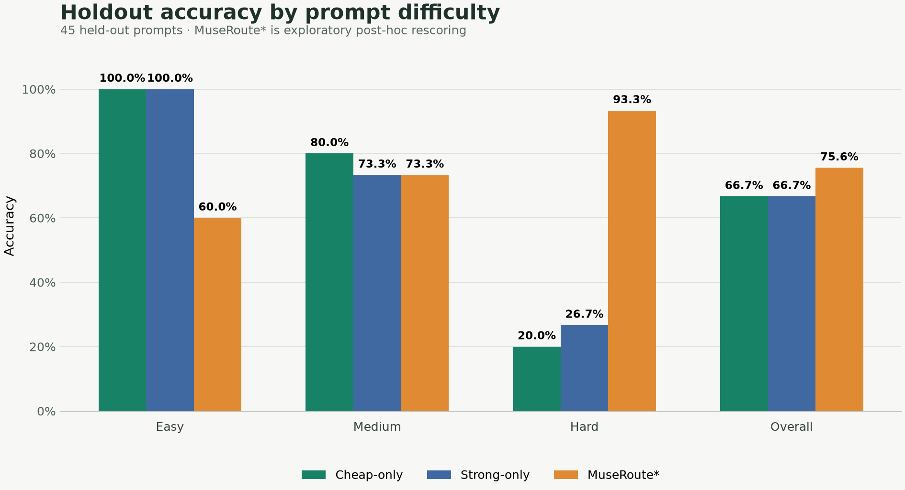
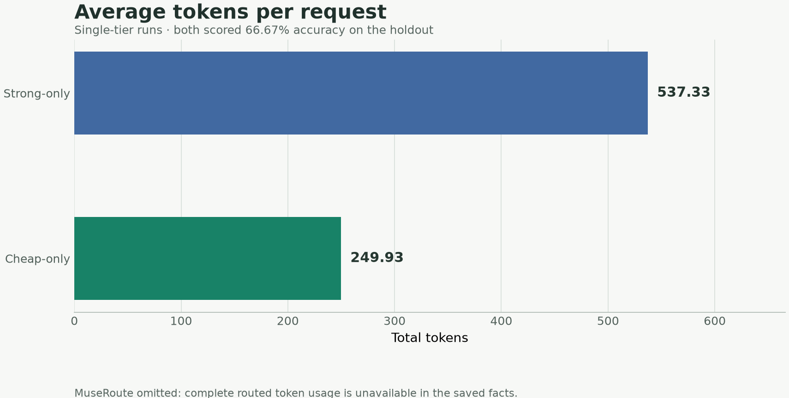
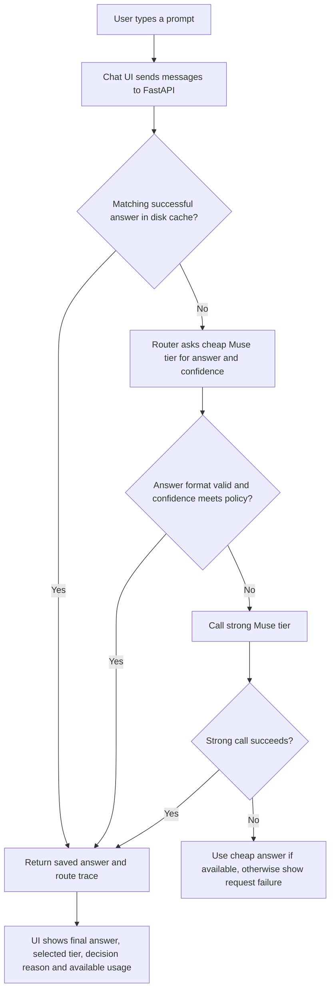

# MuseRoute

> ## 🚀 Try MuseRoute
>
> **[Open the live demo →](https://principles-hear-offshore-aquatic.trycloudflare.com/?demo=1)**
>
> Temporary public session: this link works while the demo server and tunnel are running.

## Problem and target user

Teams evaluating Meta Muse models need to see which tier the routing policy selects and how the saved outcomes compare on a held-out workload. MuseRoute is for hackathon teams and developers inspecting that experiment.

## Unique value

MuseRoute records a cheap-first Muse routing experiment and its outcomes across separate tune and held-out prompt sets.

## Key features

- **Muse-only model policy and two configured tiers:** both tiers currently use `meta/muse-glimmer-30b` on `integrate.api.nvidia.com`; [measured model and host facts](results/facts.json).
- **Cheap-first routing with a format and confidence guard:** see the [router implementation](museroute/router.py) and the saved [holdout results](results/facts.json).
- **Tune/holdout evaluation:** 45 prompts were held out from the 45-prompt tune set; inspect [all recorded facts](results/facts.json).
- **API endpoints for routing, comparison, health and facts:** see [the FastAPI service](museroute/server.py).
- **Presentation material:** [3-minute demo script](docs/DEMO_SCRIPT.md) and [judge Q&A](docs/JUDGE_QA.md).

## Existing alternatives

The four source lines referenced for this table were not included in the request (the message contains “paste the four lines from my earlier message”). To avoid unsourced descriptions or comparisons, the factual descriptions are pending those lines.

| Alternative | Factual line from supplied source |
|---|---|
| OpenRouter Auto Router | Source line not supplied. |
| Not Diamond | Source line not supplied. |
| LiteLLM Router | Source line not supplied. |
| RouteLLM | Source line not supplied. |

MuseRoute makes no claim that it beats these alternatives.

## Why MuseRoute is different

- **Muse-only:** the saved facts identify `meta/muse-glimmer-30b` for both tiers, and the project enforces a Muse model policy.
- **Accuracy guard:** the router checks answer format and self-reported confidence before deciding whether to escalate. The observed post-hoc holdout score is reported below; this does not establish that the guard generalizes.
- **Held-out evaluation:** the reported comparison uses 45 holdout prompts separate from the 45 tune prompts.

## Results

All figures below come from [results/facts.json](results/facts.json): 45 held-out prompts, with 15 in each band. 45 prompts: one prompt is about 2.2 points, so small gaps are noise.

| System | Accuracy | Escalation | Finished | Errors |
|---|---:|---:|---:|---:|
| Cheap-only | 66.67% | 0% | 45 | 0 |
| Strong-only | 66.67% | 100% | 45 | 0 |
| MuseRoute* | 75.56% | 20% | 39 | 6 |

*MuseRoute's score is exploratory post-hoc rescoring: the numeric checker was corrected after the saved holdout answers had been examined. It is not an untouched estimate of generalization. The threshold (0.5, self-consistency off) was selected on tune data only.

### Accuracy by band

| Band (15 prompts each) | Cheap-only | Strong-only | MuseRoute* |
|---|---:|---:|---:|
| Easy | 100% | 100% | 60% |
| Medium | 80% | 73.33% | 73.33% |
| Hard | 20% | 26.67% | 93.33% |
| Overall (45 prompts) | 66.67% | 66.67% | 75.56% |



### Measured token use

| System | Average total tokens/request |
|---|---:|
| Cheap-only | 249.93 |
| Strong-only | 537.33 |



MuseRoute's complete average token use is omitted because call-usage records are incomplete and six requests failed. The token chart compares only the two complete single-tier runs. Latency and cost are omitted because the saved facts do not support those comparisons; no dollar-savings claim is made.

The tier audit shows both tiers used the same model ID (`meta/muse-glimmer-30b`) and host (`integrate.api.nvidia.com`). The observed MuseRoute score is higher in this exploratory rescore, but 45 prompts cannot establish that it is better or that the result generalizes. The experiment does not establish router savings or broad reliability.

The operating point remains a tune-only choice. Cheap and strong currently use the same model ID and host, with different reasoning modes.

## What was built during the hackathon

Commit dates and subjects from Git history:

| Date | Recorded work |
|---|---|
| 2026-10-31 | Project scaffold, Muse client/policy, invented workload and checks, resumable baseline runner. |
| 2026-11-01 | Muse endpoint configuration, host-agnostic tier setup, payment-error handling. |
| 2026-11-02 | Cached router, baseline and sweep work, held-out evaluation, FastAPI server. |
| 2026-11-03 | Repository rules, completed baseline and holdout results, facts generator and facts API. |

## Setup

Use Python 3.11 from the repository root:

```powershell
py -3.11 -m venv .venv
.\.venv\Scripts\Activate.ps1
python -m pip install -r requirements.txt
Copy-Item .env.example .env
```

Set `CHEAP_BASE_URL`, `CHEAP_MODEL_ID`, `CHEAP_API_KEY`, `STRONG_BASE_URL`, `STRONG_MODEL_ID`, and `STRONG_API_KEY` in the local `.env`. The checked-in facts show the host and model ID used for the recorded measurements; credentials are not part of the facts artifact.

```powershell
pytest -q
python scripts/smoke.py
python scripts/baseline.py
python scripts/split_data.py
python scripts/sweep.py
python scripts/make_facts.py
uvicorn museroute.server:app --host 127.0.0.1 --port 8000
```

## Architecture

Both configured tiers currently use the same Meta Muse model, `meta/muse-glimmer-30b`, through `integrate.api.nvidia.com`. The cheap tier sends `reasoning_effort: low`; the strong tier sends `reasoning_effort: high`. MuseRoute therefore compares two configured modes of one Muse model, not two different model IDs. The client makes plain chat-completions HTTP requests with `requests`; it does not use a model vendor SDK.

`museroute/server.py` serves the plain HTML/CSS/JavaScript chat UI at `/` and API endpoints `/v1/chat/completions`, `/api/route`, `/api/compare`, and `/api/facts`. Workload, tune and holdout inputs are under `data/`; measured outputs and successful-answer caches are under `results/`.

### Prompt input to routed output



The router tries cheap first. It escalates when the answer is empty, a refusal, invalid for the requested format, below the configured confidence threshold, or when enabled self-consistency samples disagree. Successful answers are cached by prompt, tier and request parameters so repeats can be served locally. Failed calls are not cached. If a tier errors, the router tries the other tier when policy allows; if neither returns an answer, the UI shows the error instead of a fabricated response.

At the HTTP boundary, the UI sends a chat-completions `messages` array to `/api/route`. FastAPI calls the router, and the response includes the answer plus a `route_trace` containing the tier calls and routing decision. The `/v1/chat/completions` endpoint returns the standard completion shape with the additional `route_trace` field.

For the measured evaluation behind the charts, the workload was split into tune and holdout sets; the operating point was chosen on tune data, then evaluated on holdout. See [the data files](data/) and [saved facts](results/facts.json).

## API example

```bash
curl http://127.0.0.1:8000/v1/chat/completions \
  -H 'Content-Type: application/json' \
  -d '{"model":"museroute","messages":[{"role":"user","content":"Which number is larger, 9.11 or 9.8?"}]}'
```

Retrieve the saved evaluation facts with `curl http://127.0.0.1:8000/api/facts`.
